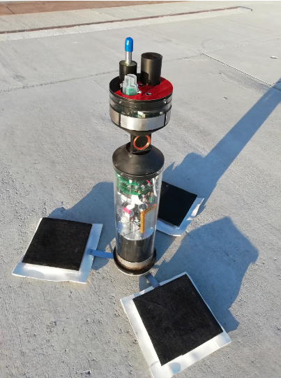
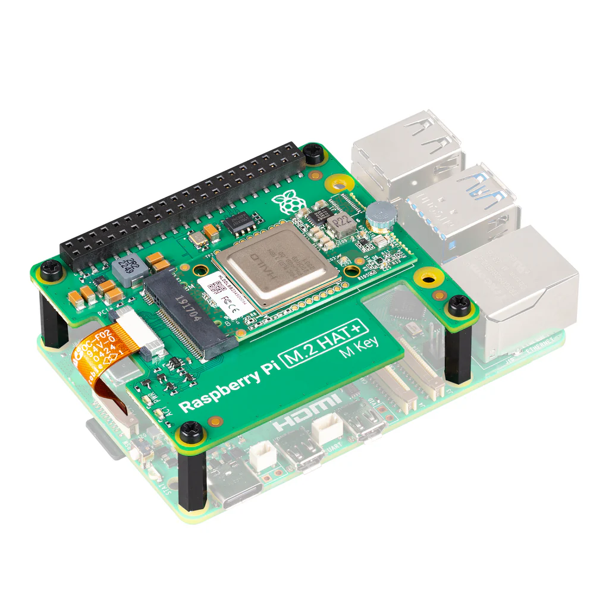
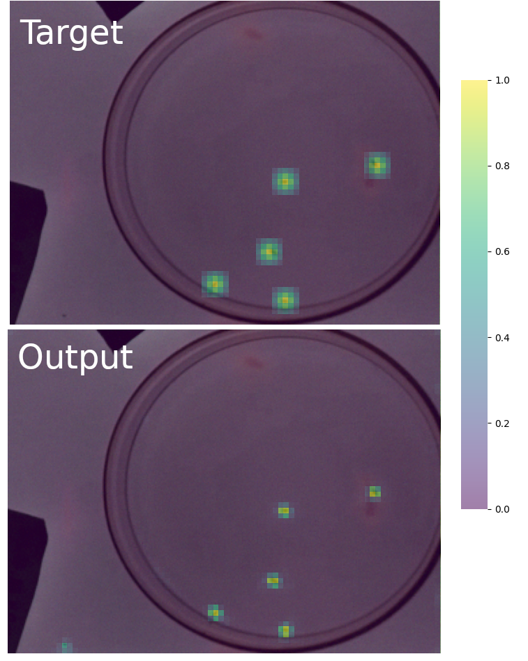
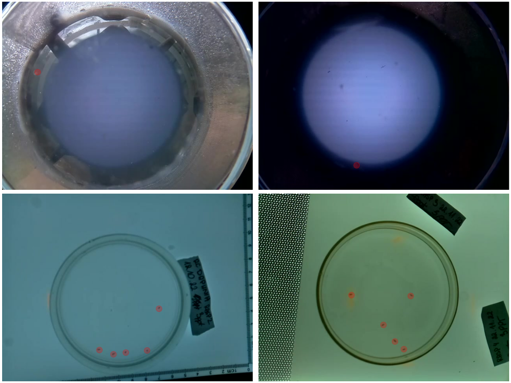
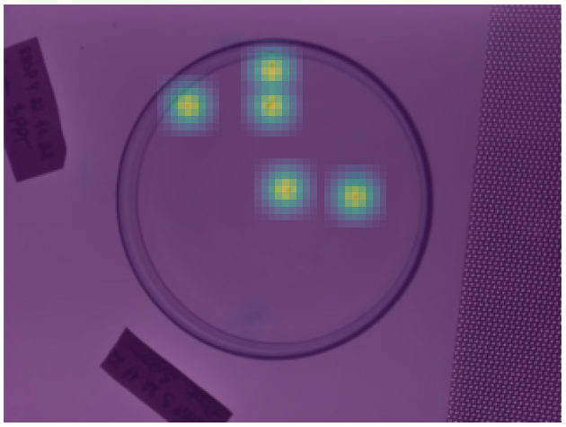
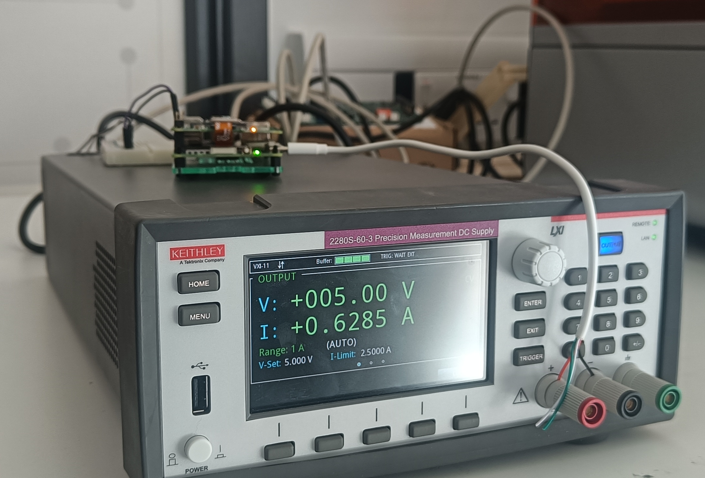
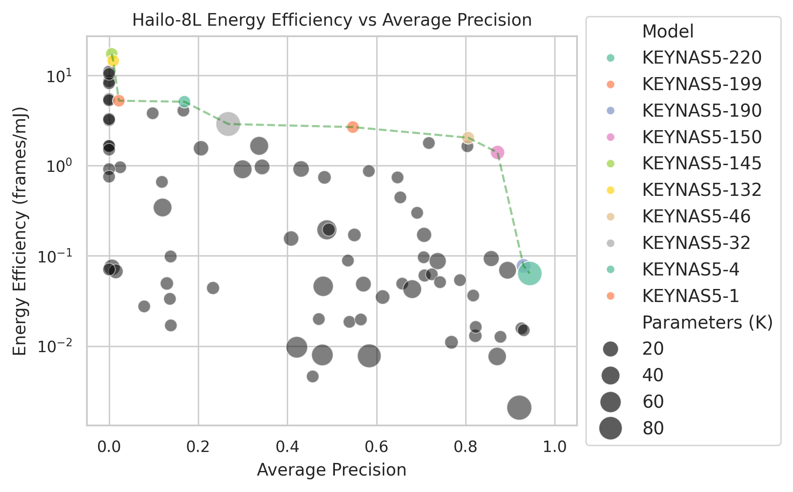

Modern computer vision often consists of throwing ever larger and more general
models at a problem, leading to small improvements in accuracy. Solutions often
leverage GPU hardware which is often expensive and power hungry.

But what about when there are significant constraints on energy? How can we optimise the model design process for this paradigm?

In my final project, I investigated how we can take what we know about the problem and the hardware to find bespoke solutions.
By doing this, we achieved on the order of 1000x energy saving per frame compared to `YOLO11-nano`, a typical off-the-shelf solution.

## Motivation: Biohybrid Devices

[**Project robocoenosis**](https://www.robocoenosis.com/) is an ambitious attempt to build submersible
biohybrid devices that use living organisms for environmental sensing. The devices would be low-cost, autonomous and left in place for an extended time, allowing researchers to collect water quality data at a scale not achievable previously.

### Organisms as Sensors

Electronic chemical sensors have two main pitfalls for this project:

1. They are expensive
2. They are designed to sense specific chemicals. Novel pollutants might not be detected but could still be harmful

Tracking the changes in behavior of existing organisms mitigates both of these, similar to sniffer dogs or even [bees](https://pmc.ncbi.nlm.nih.gov/articles/PMC4697140/). Specifically, we aim to look at _Daphnia_ (water fleas) which spin around when they are stressed.

So, any computer vision technique used onboard must minimise the energy used such that data collection can be more frequent.

### Engineering Constraints

To operate in these conditions, biohybrid devices harvest energy from the environment with microbial fuel cells (MFCs). These provide a small current, collected in capacitors until equipment can be turned on for a short period. Every millijoule counts, the less energy used, the more frequently data can be collected.

#### Edge Processing

- **High-frequency radio**: Can't penetrate water.
- **Low-frequency radio**: Large, power-hungry transmitters, low data rate.
- **Acoustic communication**: Insufficient data rate for video.
- **Store and process later**: Not real time

## Rethinking Object Detection

Modern object detection can be really complex. SOTA models predict bounding boxes, use multiple feature scales, and are massively deep. Since we only care about the position and movement patterns of _Daphnia_, which are all about the same size, we can relax the problem by **detecting keypoints instead of bounding boxes**.

## Hardware

For this project we used a Raspberry Pi 5 with a Hailo-8L neural network accelerator. This was chosen as a suitable tradeoff between development ease, energy efficiency, and cost. The methodology could be applied to other accelerators, ranging from tiny ARM Ethos chips to edge GPU devices like Nvidia Jetson.

Additionally, other onboard experiments already planned to use a Raspberry Pi.

## Dataset & Task

### Keypoint Detection

Rather than predicting bounding boxes like a traditional detector, I formulated this as a **keypoint detection** problem. The model predicts the centre point of each _Daphnia_ in the frame. This is inspired by [CenterNet](https://arxiv.org/abs/1904.07850), which frames object detection as keypoint estimation.

The model outputs two things:
1. A **heatmap** with a peak at each predicted _Daphnia_ location
2. An **offset** vector at each peak to refine the sub-pixel position

This is much simpler than full bounding box detection since we throw away the width/height estimation entirely. We only need one class, and _Daphnia_ are small enough that a single point captures everything we need for behaviour tracking.

### The Dataset

Frames were collected from previous research by the Robocoenosis project, and I annotated _Daphnia_ positions manually using [CVAT](https://www.cvat.ai/). In total there were 418 training/validation frames and 68 test frames. It's a small dataset, but sufficient for comparing architectures since training performance on a small proxy dataset can predict relative performance at scale.

The ground truth heatmap is generated by placing a Gaussian peak at each annotated point. The model learns to reproduce this heatmap. A modified focal loss (from CenterNet) handles the class imbalance, since most pixels are background, and an L1 loss trains the offset prediction.

## Architecture Search

With the task defined, the question becomes: what model architecture should we use? Rather than picking an existing design, I searched over a space of possible architectures to find ones well-suited to this specific task and hardware.

### Search Space

The search space consisted of sequential models built from a menu of building blocks:

- Standard convolutions (various kernel sizes)
- Depthwise separable convolutions
- MBConv blocks (from MobileNet)
- FusedMBConv blocks (from EfficientNetV2)
- ConvNext blocks
- Squeeze-and-Excite blocks

Each sampled architecture varied in:

| Parameter | Range |
|-----------|-------|
| Depth | 1-20 layers |
| Input resolution | 32x32 to 240x320 |
| Channels | 8-1024 (log scale) |
| Kernel sizes | 3, 5, 7 |
| Expansion ratios | 1.0-8.0 |

### Why Random Search?

I used a structured random sampling strategy. This might sound naive, but EfficientNetV2 showed that random search produces reasonable results and it's much simpler to implement than Bayesian optimization or reinforcement learning-based search. The key insight was that **almost all sampled models could learn the task to some degree**, so the search space was dense with viable solutions. Over 500 architectures were generated and evaluated.

Vision transformers were excluded despite promising initial results, as the Hailo compiler couldn't handle the tensor reshaping required between convolutional and attention formats. This is a promising avenue for future work.

## Training & Quantization

### Training

Models were trained in PyTorch on a heterogeneous GPU cluster: Durham University's NCC (NVIDIA A100 GPUs partitioned via MIG) and a desktop RTX 3080. Training jobs were distributed through an asynchronous queue system, with each node pulling pending tasks independently. Everything was tracked with Neptune.ai for experiment management.

Each model trained until convergence (AP not improving for 100 epochs), with a max of 800 epochs or 2 hours. The AdamW optimizer was used with a learning rate of 5e-4 and bfloat16 mixed precision.

### Quantization

To run on the Hailo-8L, models need to be quantized to 8-bit integers. I used a two-stage process:

1. **Post-Training Quantization (PTQ)**: calibrate scaling/clipping values using a subset of training data
2. **Quantization-Aware Training (QAT)**: fine-tune the quantized model using knowledge distillation from the full-precision version

An interesting finding: I initially tested 4-bit mixed precision (80% of weights at 4-bit), expecting energy savings. There were **no significant energy savings** compared to uniform 8-bit. The Hailo architecture apparently doesn't benefit from lower precision in the way you might expect, so all experiments used 8-bit from then on.

After quantization, models are compiled to Hailo's proprietary HEF format. This compilation process maps layers onto the accelerator's dataflow architecture using a greedy allocation algorithm.

## Energy Measurement

This is where the project gets hands-on. To measure the actual energy used per frame, I set up a precision measurement rig.

### Setup

A Keithley 2280S precision power supply powered the Raspberry Pi while simultaneously measuring current draw at 100 Hz. The Pi triggers measurements via GPIO for precise timing synchronization, following principles from the [MLPerf Power](https://arxiv.org/abs/2410.12032) benchmark methodology.

The measurement captures the entire system power draw during inference. I took care to control for noise: the system cools down between experiments until temperatures stabilise, wireless communication is disabled, and Python garbage collection is paused during measurement windows.

For a CPU baseline, each model was also benchmarked in full-precision ONNX format on the Pi's CPU.

## Results

### The Energy-Accuracy Tradeoff

The headline result is the energy-accuracy Pareto frontier. This shows the best models at each energy level, and the tradeoff is stark: **improving AP from 0.88 to 0.96 costs roughly 10x more energy per frame**. The diminishing returns are dramatic.

A few things stand out:

- **All Pareto-optimal models are shallow** (max 5 layers). This is a striking contrast with SOTA models which are often tens or hundreds of layers deep, even those designed for efficiency.
- **Tiny inputs work surprisingly well**: a 56x56 input resolution achieves AP > 0.5. For balanced accuracy and efficiency (AP > 0.85, <0.1 mJ per frame), resolutions of 120x160 or 128x128 are the sweet spot.
- The **Pareto front differs between CPU and accelerator**, meaning different architectures are optimal for different hardware. This reinforces the need for hardware-specific optimization.

### The Best Model

Among the Pareto-optimal set, **KEYNAS5-204** hits a sweet spot. It's tiny: just 3 layers with a maximum of 48 channels, processing 192x192 input.

| | KEYNAS5-204 | YOLO11-nano |
|---|---|---|
| FPS | 5,167 | 73 |
| Energy per frame | 2.2 uJ | 1,449 uJ |

That's a **680x energy improvement** over YOLO11-nano while achieving an AP of 0.9479 on our task. The entire model is essentially two convolutions and a detection head.

### Energy-Latency Correlation

One of the most practically useful findings: on the Hailo-8L, energy and latency are almost perfectly correlated (r²=0.9966). The accelerator maintains roughly constant power draw regardless of what operations it's running. This means **optimising for speed is equivalent to optimising for energy**, which massively simplifies the design process since latency is much easier to measure than energy.

### Why Predicting Accelerator Energy is Hard

I tried to build regression models predicting energy from architectural features (MACs, parameter count, memory operations, depth, etc.). On the CPU, these features explained **80% of energy variance**, with MAC count alone accounting for 77%. Makes sense.

On the Hailo-8L accelerator? The same features explained only **15% of variance**. The proprietary compilation process transforms the model graph in opaque ways, and the dataflow architecture's energy characteristics don't map neatly to the architectural features we can observe. The takeaway: for accelerator targets, there's no shortcut. You have to measure on the actual hardware.

### Quantization Impact

PTQ caused a mean AP drop of 0.06, with some models hit harder than others. QAT was more variable: 42% of models actually *improved* after QAT (mean improvement of 0.11 AP in that subset), while others degraded further. Neither PTQ impact nor QAT benefit correlated well with any architectural features, making it hard to predict which models will quantize gracefully.

The top-end accuracy does drop slightly at int8 (90th percentile AP from 0.955 to 0.912), but for our use case this difference is negligible.

## Conclusion

The core lesson from this project is that **reframing the problem matters more than scaling the model**. By simplifying detection to keypoints, searching over hardware-specific architectures, and carefully measuring real energy consumption, we found models that are orders of magnitude more efficient than off-the-shelf solutions. The best model uses just 2.2 microjoules per frame while maintaining strong detection accuracy.

For practitioners working under energy constraints, the results suggest: question whether you need the full generality of a standard detector, search over simple architectures rather than assuming depth is necessary, and always measure on your target hardware since accelerator behaviour can be surprising and hard to predict from architectural features alone. The range of Pareto-optimal models also opens the door to dynamic model selection, switching between accuracy levels based on available energy.

Looking ahead, I'm excited about the potential for vision transformers on edge accelerators as compiler support matures, and for applying this methodology to even more constrained "tiny-scale" accelerators. There's a lot of room to push the boundaries of what's possible with millijoules of energy.

This project was supervised by Dr Farshad Arvin at Durham University, who I'd like to thank for his support and guidance throughout.
